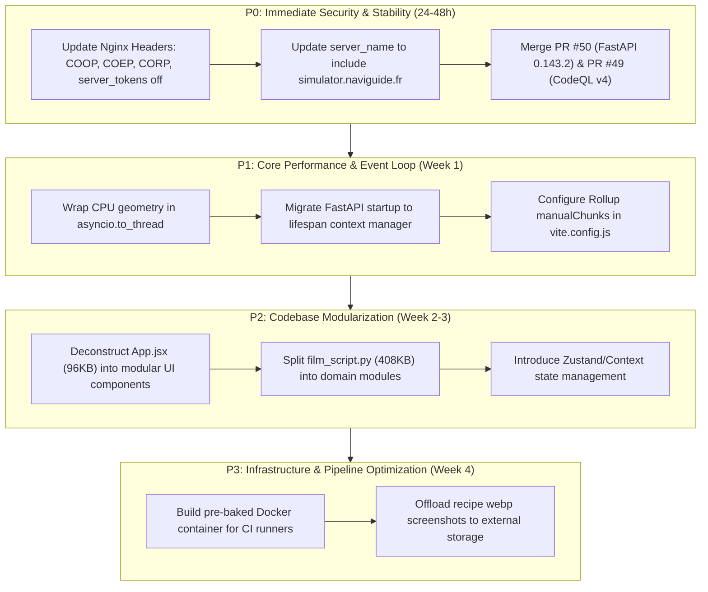

# ⚖️ NAVIGUIDE Codebase Audit & Judicial Evaluation Report

**Repository:** `Berry-Mappemonde/NAVIGUIDE`  
**Target Domain:** `naviguide.fr` / `simulator.naviguide.fr`  
**Auditor Role:** Senior Software Architect & Security Judge  
**Date:** October 2026  
**Status:** Comprehensive Review Completed  

---

## 🏛️ 1. Executive Verdict & Judicial Scorecard

| Dimension | Grade | Status | Summary Assessment |
| :--- | :---: | :---: | :--- |
| **Security & Hardening** | **C-** | ⚠️ At Risk | Missing critical isolation headers (COOP, COEP, CORP), wildcard CSP directives, server version leakage, and unencrypted coordinate logging in URL queries. |
| **Backend Architecture** | **C+** | ⚠️ Needs Refactoring | Heavy CPU & file I/O operations block FastAPI's async event loop; massive monolithic files (>400KB); deprecated startup hooks. |
| **Frontend Architecture** | **B-** | ⚠️ Tech Debt | `App.jsx` is a 96KB monolithic single-file React component with tightly coupled state; lacks code-splitting for heavy map bundles. |
| **CI/CD & DevOps** | **B+** |  Robust but Heavy | Comprehensive Playwright test coverage (6 shards) and ZAP scanning, but CI builds re-download heavy wheels on each run; Git repository is bloated (~141MB) due to unmanaged media assets. |
| **Dependency Health** | **B** | ⚠️ Pending Updates | Strict `==` pinning creates dependency lag; open PRs for FastAPI (PR #50), CodeQL (PR #49), and React/Playwright (PR #48) need resolution. |

**Overall Verdict:**  
NAVIGUIDE is an ambitious and mathematically sophisticated maritime routing and simulation platform combining GRIB weather pipelines, polar diagram calculations, and satellite climatology. However, **the codebase suffers from severe architectural monoliths, event-loop starvation vulnerabilities, and critical web security misconfigurations** that have already triggered automated alerts from OWASP ZAP and Dependabot.

---

## 🔍 2. Detailed Audit of the 5 Existing Open Issues

### 🔴 Finding 1 (Issue #2): OWASP ZAP Baseline Security Scan Vulnerabilities
* **Reported Source:** GitHub Issue #2 (`ZAP baseline — simulateur`) by `github-actions[bot]`
* **Target:** `https://simulator.naviguide.fr`

#### Sub-Issues & Root Causes:
1. **Content Security Policy (CSP) in Report-Only & Wildcards:**
   * **Problem:** CSP is deployed in `Content-Security-Policy-Report-Only` instead of enforced mode, and uses wildcards `connect-src 'self' https:; img-src 'self' data: blob: https:;`.
   * **Reason:** Overly permissive `https:` directives allow data exfiltration to any arbitrary HTTPS endpoint or injection of untrusted third-party image payloads.
   * **Solution:** Transition CSP to enforcement mode. Lock down origins to explicit domains:
     ```nginx
     add_header Content-Security-Policy "default-src 'self'; script-src 'self'; style-src 'self' 'unsafe-inline'; img-src 'self' data: blob: https://*.tile.openstreetmap.org https://*.openseamap.org https://server.arcgisonline.com; connect-src 'self' https://blueintelligence.online https://server.arcgisonline.com; font-src 'self' data:; frame-ancestors 'self' https://*.naviguide.fr https://blueintelligence.online; object-src 'none'; base-uri 'self';" always;
     ```

2. **Missing Cross-Origin Isolation Headers (COOP, COEP, CORP):**
   * **Problem:** ZAP flagged missing `Cross-Origin-Opener-Policy`, `Cross-Origin-Embedder-Policy`, and `Cross-Origin-Resource-Policy`.
   * **Reason:** Browser isolation mechanisms like `SharedArrayBuffer` and protection against Spectre/cross-origin leak attacks require explicit isolation headers.
   * **Solution:** Add the following headers to `infra/vps/naviguide/nginx-simulator.conf`:
     ```nginx
     add_header Cross-Origin-Opener-Policy "same-origin" always;
     add_header Cross-Origin-Embedder-Policy "credentialless" always;
     add_header Cross-Origin-Resource-Policy "same-origin" always;
     ```

3. **Server Daemon & Version Information Disclosure:**
   * **Problem:** HTTP response headers leak `Server: uvicorn` and Nginx daemon versions (`10036`).
   * **Reason:** `server_tokens off;` is omitted in Nginx, and Uvicorn forwards its server signature header.
   * **Solution:**
     * In Nginx config:
       ```nginx
       server_tokens off;
       proxy_hide_header Server;
       ```
     * In FastAPI / Uvicorn startup (`dev` & `prod`):
       ```bash
       uvicorn server.main:app --host 127.0.0.1 --port 8010 --no-server-header
       ```

4. **Missing HSTS on `simulator.naviguide.fr`:**
   * **Problem:** ZAP reported `Strict-Transport-Security Header Not Set` on `simulator.naviguide.fr`.
   * **Reason:** In `infra/vps/naviguide/nginx-simulator.conf`, the directive is configured under `server_name naviguide.fr;` instead of explicitly binding `simulator.naviguide.fr`.
   * **Solution:** Update Nginx server name:
     ```nginx
     server_name simulator.naviguide.fr naviguide.fr;
     ```

5. **Sensitive Information Disclosure in Query Strings:**
   * **Problem:** High-precision GPS coordinates, vessel trajectory parameters, and months are passed via GET query parameters (`/ici?lat=-6.948342882418766&lon=-116.4325806465071&thin=1&month=10`).
   * **Reason:** GET query parameters are logged in plaintext across intermediate proxies, Cloudflare access logs, browser history, and HTTP `Referer` headers.
   * **Solution:** Convert sensitive spatial inspection requests to HTTP `POST` with a JSON payload or truncate coordinate precision to 4 decimal places (~11 meters) to reduce fingerprinting risks.

---

### 🟡 Finding 2 (PR #50): FastAPI Dependency Bump (0.142.2 → 0.143.2)
* **Reported Source:** GitHub PR #50
* **File:** `naviguide-simulator/server/requirements.txt`
* **Problem & Reason:**
  FastAPI 0.142.2 contained a bug where fallback file checks in static asset delivery could block the asynchronous worker thread. Furthermore, version 0.143.0+ modernized OpenTelemetry auto-configuration to opt-in, avoiding memory leaks when tracing was inactive.
* **Why it needs improvement:**
  Leaving FastAPI pinned to `0.142.2` risks worker thread deadlocks and prevents critical bug fixes from reaching production.
* **Solution:**
  Merge PR #50 and update `requirements.txt`:
  ```text
  fastapi==0.143.2
  ```

---

### 🟡 Finding 3 (PR #49): CodeQL GitHub Action Upgrade (v3 → v4)
* **Reported Source:** GitHub PR #49
* **File:** `.github/workflows/codeql.yml`
* **Problem & Reason:**
  CodeQL Action v3 relies on older CodeQL CLI bundles (<2.21.2) that were discontinued in September 2026. Action v4 introduces native Linux ARM64 support, reduced bundle sizes via per-language downloads, and toolcache cleanup.
* **Why it needs improvement:**
  Workflows using deprecated actions will soon fail or stop receiving security scanning rule updates.
* **Solution:**
  Update `.github/workflows/codeql.yml`:
  ```yaml
  - name: Initialize CodeQL
    uses: github/codeql-action/init@v4
    with:
      languages: ${{ matrix.language }}
  - name: Perform CodeQL Analysis
    uses: github/codeql-action/analyze@v4
  ```

---

### 🟡 Finding 4 (PR #48): Frontend Dependency Upgrades
* **Reported Source:** GitHub PR #48
* **Files:** `naviguide-simulator/package.json` & `package-lock.json`
* **Updates:** `react` (19.1.1 → 19.3.1), `lucide-react` (1.54.0 → 1.57.0), `@playwright/test` (1.64.0 → 1.64.1)
* **Problem & Reason:**
  * React 19.3.1 fixes RSC transport protocol edge cases.
  * Playwright 1.64.1 fixes a regression in Chromium 155+ where preflighted cross-origin redirects aborted (`net::ERR_ABORTED`), directly impacting the E2E test suite.
* **Solution:**
  Merge PR #48, execute `npm audit fix`, and verify with `npm test`.

---

### 🔵 Finding 5 (Issue #1): Devpost Automated Submission Agent Workflow
* **Reported Source:** GitHub Issue #1
* **Components:** `infra/agents/devpost_answers.py` & `infra/agents/GROK_BOT_DEVPOST.md`
* **Problem & Reason:**
  Issue #1 functions as a staging queue between autonomous bots (Grok Bot and Agent Fable) and human project maintainers for hackathon/Devpost submissions. The manual verification step requires strict integrity verification to prevent automated bots from executing premature submissions.
* **Solution:**
  Maintain the current 3-comment protocol: Formulaire Relevé → Réponses Proposées → Brouillon Rempli. Add automated JSON schema validation for both comments to reject malformed submissions before maintainer review.

---

## ⚙️ 3. Deep-Dive Codebase & Architecture Audit

### 🚨 Architectural Flaw 1: Async Event Loop Starvation
* **Location:** `naviguide-simulator/server/main.py`, `ici_engine.py`, `weather_pipeline.py`
* **The Problem:**
  FastAPI runs on an asynchronous event loop (`asyncio`). However, multiple endpoints execute synchronous, CPU-intensive geometry calculations (e.g. Shapely polygon intersections, global land mask queries, GRIB2 NetCDF decoding, and PIL image manipulations) directly within `async def` route handlers.
* **Root Cause:**
  When a synchronous call like `shapely.geometry.Point.within()` or `copernicus.getWind` runs inside an `async def` function, it halts the entire event loop thread until completion. No other requests (including lightweight heartbeat endpoints like `/clock` or `/film`) can be processed. This caused Cloudflare 524 timeouts in production.
* **Solution:**
  1. For existing CPU-bound functions, wrap their execution in `asyncio.to_thread()`:
     ```python
     # Before:
     data = compute_heavy_spatial_index(bbox)

     # After:
     data = await asyncio.to_thread(compute_heavy_spatial_index, bbox)
     ```
  2. For regular I/O routes that do not need async streaming, declare them as standard synchronous functions (`def endpoint()` instead of `async def endpoint()`). FastAPI automatically offloads standard `def` endpoints to its internal `ThreadPoolExecutor`.

---

### 🚨 Architectural Flaw 2: Massive Monolithic "God Files"
* **Locations:**
  * `naviguide-simulator/server/film_script.py` (~408 KB)
  * `naviguide-simulator/server/official_store.py` (~114 KB)
  * `naviguide-simulator/src/App.jsx` (~96 KB, >2,500 lines)
  * `naviguide-simulator/server/logbook_chat.py` (~74 KB)
* **The Problem:**
  `App.jsx` handles state management, timeline scrubbing, map tile layers, modal rendering, audio effects, and weather displays all within a single React component. Similarly, `film_script.py` combines narrative text generation, route math, and API payloads into 408KB of code.
* **Root Cause:**
  Rapid feature additions without periodic refactoring or domain-driven separation of concerns.
* **Impact:**
  * Every minor state update triggers component-wide re-renders in React, degrading 60fps map animations.
  * Extremely difficult unit testing, high risk of regression, and merge conflicts.
* **Solution:**
  * **Frontend Refactor:** Split `App.jsx` into focused sub-components:
    * `components/map/MapView.jsx`
    * `components/timeline/TimelineBar.jsx`
    * `components/panels/HereSheet.jsx`
    * `components/panels/LogbookDrawer.jsx`
    * Implement a centralized state store via `Zustand` or React Context (`SimulationContext`).
  * **Backend Refactor:** Split `film_script.py` and `official_store.py` into modular packages:
    * `server/film/generator.py`, `server/film/models.py`, `server/film/narratives.py`.

---

### ⚠️ Architectural Flaw 3: Deprecated FastAPI Startup/Shutdown Handlers
* **Location:** `naviguide-simulator/server/main.py` (lines 80-140)
* **The Problem:**
  ```python
  @app.on_event("startup")
  def _startup_official_grib():
      ...

  @app.on_event("startup")
  async def _startup_ici_warm():
      ...
  ```
* **Root Cause:**
  FastAPI and Starlette have officially deprecated `@app.on_event` in favor of the `lifespan` context manager pattern.
* **Solution:**
  Refactor `main.py` to use `lifespan`:
  ```python
  from contextlib import asynccontextmanager

  @asynccontextmanager
  async def lifespan(app: FastAPI):
      # Startup tasks
      _startup_official_grib()
      await _startup_ici_warm()
      yield
      # Shutdown / cleanup tasks
      # Close HTTP client connections, DB pools

  app = FastAPI(
      title="NAVIGUIDE simulator",
      lifespan=lifespan,
      version="0.1.0"
  )
  ```

---

### ⚠️ Architectural Flaw 4: Repository Bloat & Cloning Bottlenecks
* **The Problem:**
  Cloning the repository times out on standard connections because the repository size is ~141 MB despite having relatively small application source code.
* **Root Cause:**
  1. The `docs/recette/` directory contains dozens of uncompressed screenshots and recipe assets (`01-attribution.webp`, `02-briefing.webp`, etc.) committed directly to Git history.
  2. The repository contains over 84 pull requests and remote feature branches tracked in Git packfiles.
* **Solution:**
  1. **Immediate Shallow Clone Command for Fast Local Work:**
     ```bash
     git clone --depth 1 --single-branch --branch main https://github.com/Berry-Mappemonde/NAVIGUIDE.git .
     ```
  2. **Long-Term Repository Health:**
     * Migrate visual verification screenshots to an external S3/CDN bucket or track them with `git-lfs`.
     * Run `git-filter-repo` or BFG Repo-Cleaner to clean legacy binary blobs from git history if repository size reduction is required.

---

### ⚠️ Architectural Flaw 5: Vite Dev Server Permissive Network Binding
* **Location:** `naviguide-simulator/vite.config.js`
* **The Problem:**
  ```javascript
  server: {
    host: "0.0.0.0",
    port: 5174,
    allowedHosts: [".trycloudflare.com", ".blueintelligence.online", ...],
  }
  ```
* **Root Cause:**
  Binding to `0.0.0.0` exposes the development server on all network interfaces (LAN, Wi-Fi), and wildcard `.trycloudflare.com` allows DNS rebinding across any Cloudflare tunnel.
* **Solution:**
  Restrict default dev binding to `127.0.0.1` and bind `0.0.0.0` only when explicitly specified via environment variable (`HOST=0.0.0.0 npm run dev`).

---

### ⚠️ Architectural Flaw 6: CI/CD Execution Overhead
* **Location:** `.github/workflows/ci.yml`
* **The Problem:**
  Every PR triggers 6 parallel Playwright shards (`simulator-e2e 1/6` to `6/6`). Each runner independently runs:
  `pip install -r server/requirements.txt` (installing heavy packages like `copernicusmarine`, `xarray`, `numpy`, `h5py`, `shapely`, `pandas`).
* **Root Cause:**
  Lack of containerized CI environment.
* **Impact:**
  Massive CI compute minute consumption (~30-40 runner minutes per PR) and network bandwidth strain.
* **Solution:**
  Build and publish a base Docker image (`ghcr.io/berry-mappemonde/naviguide-ci-base:latest`) containing pre-installed Python dependencies and Playwright browsers. In `ci.yml`, use `container: ghcr.io/berry-mappemonde/naviguide-ci-base:latest` to eliminate `pip install` overhead entirely.

---

## 📋 4. Prioritized Action Plan & Implementation Roadmap



### Milestone Checklist:
- [ ] **P0.1**: Add security headers (`COOP`, `COEP`, `CORP`, `HSTS`, `server_tokens off`) in `infra/vps/naviguide/nginx-simulator.conf`.
- [ ] **P0.2**: Merge PR #50, PR #49, and PR #48.
- [ ] **P1.1**: Refactor `server/main.py` lifecycle from `@app.on_event` to `lifespan`.
- [ ] **P1.2**: Offload synchronous Shapely and GRIB queries in `ici_engine.py` using `asyncio.to_thread`.
- [ ] **P2.1**: Break `App.jsx` into modular React sub-components under `src/components/`.
- [ ] **P2.2**: Split `film_script.py` and `official_store.py` into separate service modules.
- [ ] **P3.1**: Containerize CI test runners to eliminate pip package download times on GitHub Actions.
